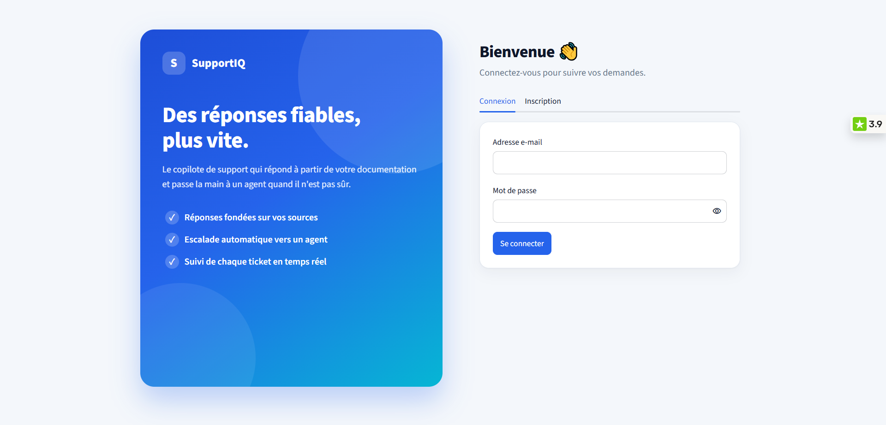
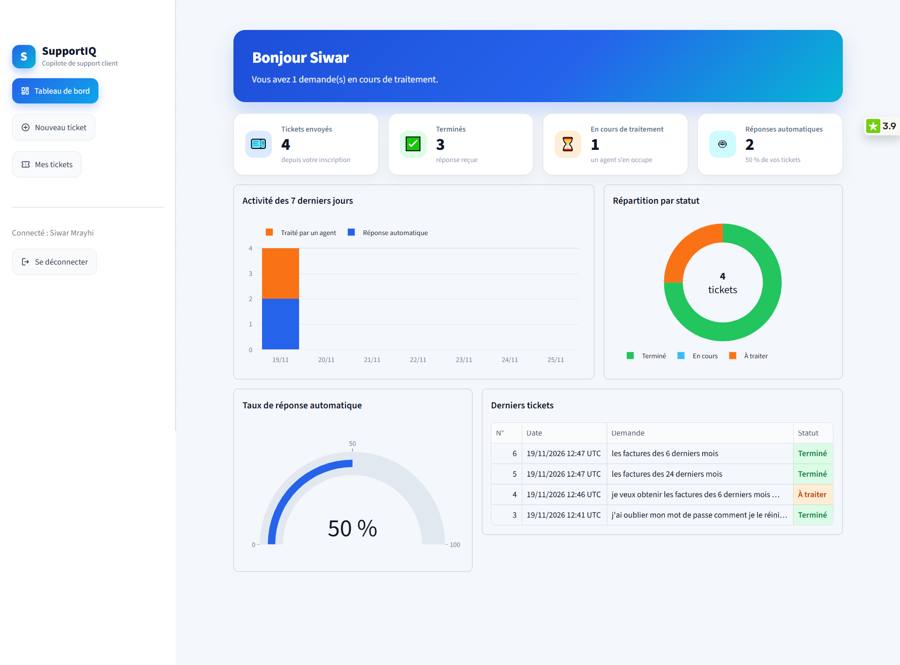
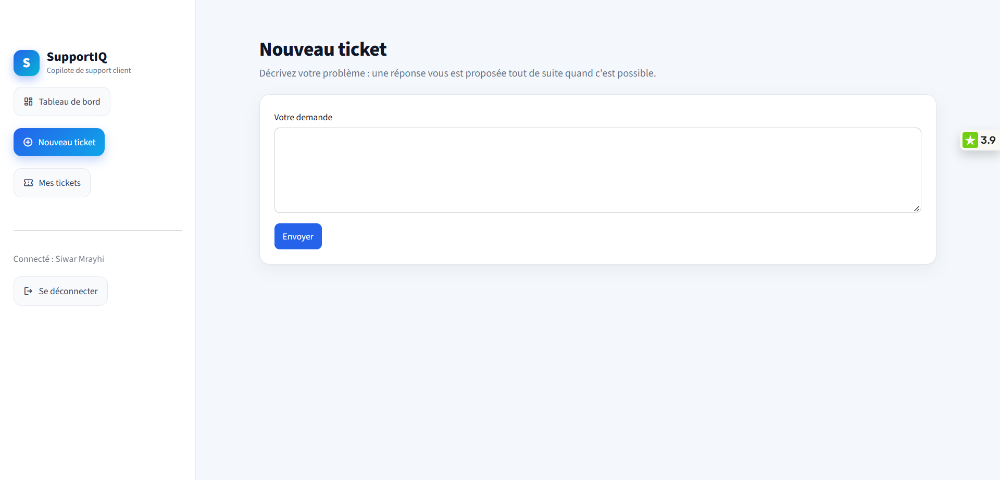
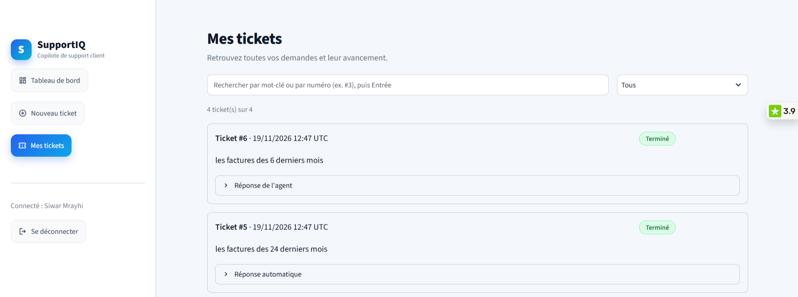
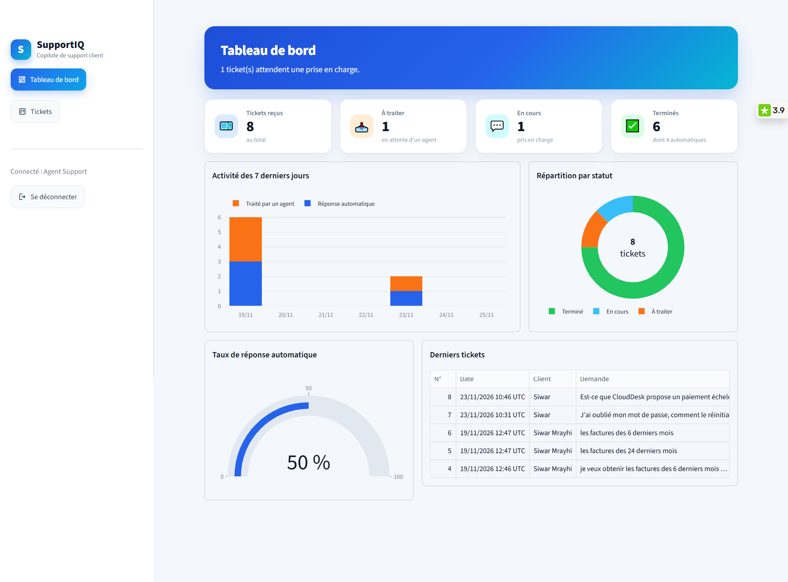
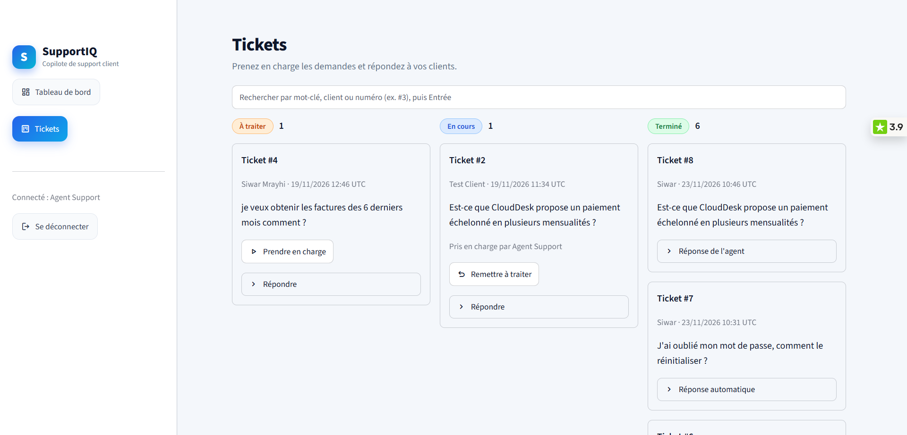
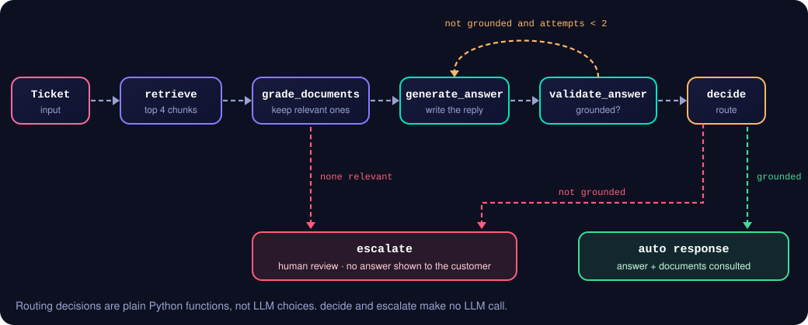
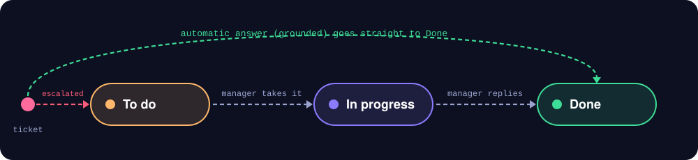

<div align="center">



<br/>


<br/><br/>

**Ticket → retrieve → grade → answer → validate → decide: a sourced answer, or a handover to a human.**

*Project by [Siwar Mrayhi](https://github.com/siwarmrayhi).*

</div>

<br/>

A support copilot that answers customer tickets **only from a knowledge base**, double-checks its own answer, and **hands the ticket to a human agent when it is not sure**. It never invents an answer.

The demo company is **CloudDesk**, a fictional SaaS product (projects, teams, subscriptions, payments, accounts). The knowledge base and the evaluation set are in French.

> **Status:** working end to end (pipeline, API, database, authentication, client and manager interfaces). Docker packaging is planned.

---

## 🎬 Demo

<div align="center">

<!-- Replace YOUR_DEMO_LINK with the link to your demo video -->
<a href="YOUR_DEMO_LINK">
  
</a>

</div>

The demo follows a ticket end to end: a customer sends a question, the copilot answers from the knowledge base with its sources or escalates it, and a manager takes the ticket on the kanban board and replies.

---

## 📸 Preview

<table>
  <tr>
    <td align="center" colspan="2">
      <br/>
      <b>Authentication</b><br/>
      <sub>Sign up and log in. Accounts created from the interface are always clients.</sub>
    </td>
  </tr>
  <tr>
    <td align="center" width="50%" valign="top">
      <br/>
      <b>Client dashboard</b><br/>
      <sub>An overview of the customer's own tickets.</sub>
    </td>
    <td align="center" width="50%" valign="top">
      <br/>
      <b>Send a ticket</b><br/>
      <sub>The copilot answers from the knowledge base, or escalates the ticket.</sub>
    </td>
  </tr>
  <tr>
    <td align="center" valign="top">
      <br/>
      <b>My tickets</b><br/>
      <sub>Follow each ticket and read the answer with the documents consulted.</sub>
    </td>
    <td align="center" valign="top">
      <br/>
      <b>Manager dashboard</b><br/>
      <sub>An overview of the ticket activity for the support team.</sub>
    </td>
  </tr>
  <tr>
    <td align="center" colspan="2">
      <br/>
      <b>Ticket management</b><br/>
      <sub>Kanban board (To do → In progress → Done): take a ticket and reply to close it.</sub>
    </td>
  </tr>
</table>

---

## 📑 Table of contents

- [Demo](#-demo)
- [Preview](#-preview)
- [What it does](#-what-it-does)
- [How a ticket flows](#-how-a-ticket-flows)
- [Tech stack](#-tech-stack)
- [Evaluation](#-evaluation)
- [PDF ingestion and OCR](#-pdf-ingestion-and-ocr)
- [Getting started](#-getting-started)
- [API](#-api)
- [Security notes](#-security-notes)
- [Project structure](#-project-structure)
- [Known limitations](#-known-limitations)
- [Roadmap](#-roadmap)

---

## 🎯 What it does

| | Capability | Details |
|:-:|---|---|
| 📚 | **Answers from sources** | Retrieves chunks of the knowledge base, keeps only those that really answer the ticket, writes a reply, and lists the documents consulted. |
| 🛑 | **Refuses instead of guessing** | If nothing relevant is found, or the reply is not supported by the documents, the ticket is escalated and no answer is shown to the customer. |
| 🎫 | **Full ticket workflow** | Customers sign up, send tickets and follow them. Managers work a kanban board (To do → In progress → Done) and reply. |
| 📄 | **Reads scanned PDFs** | Native text first, OCR (Tesseract) as a fallback. |

---

## 🔀 How a ticket flows

<div align="center">

</div>

Routing decisions are plain Python functions, not LLM choices, so the flow is predictable and testable. The final decision (`decide`, `escalate`) makes no LLM call.

### Ticket status in the application

<div align="center">

</div>

An automatic answer goes straight to **Done**; an escalated ticket goes to **To do**, then **In progress** when a manager takes it, then **Done** when the manager replies.

---

## 🧰 Tech stack

| Layer | Choice |
|---|---|
| Orchestration | LangGraph (state machine with a bounded regeneration loop) |
| LLM | Gemini via Google AI Studio (model set in `.env`) |
| Embeddings | `BAAI/bge-m3`, local, CPU (multilingual) |
| Vector store | ChromaDB (HNSW index) |
| Structured LLM output | Pydantic (`with_structured_output`) |
| OCR | Tesseract (French) through `pytesseract`, PyMuPDF for PDF pages |
| API | FastAPI, SQLAlchemy, SQLite |
| Auth | bcrypt password hashes, signed JWT access tokens |
| Interface | Streamlit, Plotly |
| Tests | pytest |

---

## 📊 Evaluation

20 annotated tickets (`eval/dataset.jsonl`) against a 10-document corpus (39 chunks): 7 nominal cases, 6 **refusal traps** (topics absent from the corpus, some very close to it), 4 with an exact identifier (error codes, plan names), 3 needing several documents. The tickets were written **before** the corpus.

<div align="center">

</div>

| Version | What is measured | Result |
|---|---|---|
| Retrieval only (dense, top 4) | Recall@4 / MRR | 100 % / 0.893 (0.750 on identifier tickets) |
| + document grading | Correct decision (answer or escalate) | 20/20, identical on two runs |
| + answer validation | Correct decision | 19/20, **6/6 refusals correct** |

Recall says the right document is in the top 4; MRR says at which rank. MRR revealed that exact error codes are sometimes ranked second even though recall was perfect.

### Findings worth noting

- Two prompts contradicted each other: the writer was told to state what the documents do not cover, and the validator rejected any sentence not supported by a document. Fixed by telling the validator that declaring missing information is not a claim to verify.
- One ticket (T007) is unstable: the writer sometimes adds a conclusion the documents do not state ("24 months covers your 6 months") and the strict validator escalates it. The model ignores the `temperature` setting, so the outcome varies between runs.

---

## 📄 PDF ingestion and OCR

Each PDF page is read as text when it has a text layer; otherwise it is rendered at 300 dpi and read with Tesseract. The extraction method (`native`, `ocr`, `mixed`) is stored in the chunk metadata, and a document yielding almost no text is skipped with a warning instead of being indexed empty.

Robustness measured on one synthetic scan:

| Defect | Reads well up to | Breaks at |
|---|---|---|
| Rotation | 5° | 10° |
| Blur | radius 1.5 | radius 3 |
| Noise | sigma 40 | sigma 80 |
| Resolution | 40 % (one error code of three lost) | 30 % |

Degradation is abrupt, not gradual. The arrow `→` is never read correctly, and exact codes are the first thing lost. Upscaling the image before OCR recovers a 40 % resolution scan and partly a 30 % one.

---

## 🚀 Getting started

Requirements: Python 3.12, a Google AI Studio API key. For scanned PDFs, install [Tesseract](https://github.com/UB-Mannheim/tesseract/wiki) with the French language data (`fra`).

```powershell
git clone https://github.com/siwarmrayhi/Support-IQ.git
cd Support-IQ
python -m venv .venv
.\.venv\Scripts\Activate.ps1
pip install torch --index-url https://download.pytorch.org/whl/cpu
pip install -r requirements.txt
```

Copy `.env.example` to `.env` and fill it in:

```text
GOOGLE_API_KEY=your_key
LLM_MODEL=gemini-3.5-flash-lite
EMBEDDING_MODEL=BAAI/bge-m3
EMBEDDING_DEVICE=cpu
JWT_SECRET=a_long_random_string
ACCESS_TOKEN_MINUTES=60
```

Generate a secret with `python -c "import secrets; print(secrets.token_hex(32))"`.

```powershell
python -m scripts.check_setup        # checks PyTorch, the LLM key and the embedding model
python -m scripts.ingest             # builds the vector index from data/raw
python -m scripts.init_db            # creates the database tables
python -m scripts.create_manager --email manager@example.com --name "Support Agent"

python -m uvicorn supportiq.api.main:app --reload     # API on http://127.0.0.1:8000/docs
python -m streamlit run ui\streamlit_app.py           # interface on http://localhost:8501
```

> The first run downloads `bge-m3` (about 2.2 GB). Customers sign up from the interface; managers can only be created with the script.

### Tests and evaluation

```powershell
python -m pytest -q                       # unit tests: no LLM call, no network
python -m scripts.run_eval                # retrieval metrics (Recall@4, MRR)
python -m scripts.run_eval_pipeline       # full pipeline on the 20 tickets (uses LLM quota)
```

The unit tests run against an in-memory database and a fake pipeline.

---

## 🔌 API

| Endpoint | Role | Purpose |
|---|---|---|
| `POST /auth/signup`, `POST /auth/login`, `GET /auth/me` | all | Account creation (always a client), login, profile |
| `POST /tickets`, `GET /tickets`, `GET /tickets/{id}` | client | Send a ticket, list own tickets, read one |
| `GET /manager/tickets` | manager | All tickets, optional `?status=` filter |
| `PATCH /manager/tickets/{id}/status` | manager | Take over / put back to "To do" |
| `POST /manager/tickets/{id}/reply` | manager | Reply and close the ticket |
| `GET /health` | all | Liveness |

If the pipeline fails (network, quota), the ticket is still stored and sent to human review.

---

## 🔒 Security notes

- Passwords are stored as bcrypt hashes; tokens are signed and expire; roles are re-read from the database on every request, not trusted from the token.
- A client only sees their own tickets (another client's ticket returns 404). Managers cannot self-register or create tickets.
- Login returns the same error for an unknown e-mail and a wrong password.
- User-written text is never injected as HTML in the interface.
- `.env` and the database file are git-ignored.
- The free tier of Gemini may use prompts to improve Google's products: do not send real customer data without a paid tier or another provider.

---

## 📁 Project structure

```text
supportiq/
  api/        FastAPI routes, dependencies, schemas
  db/         SQLAlchemy models and connection
  graph/      LangGraph state, routing functions, workflow
  nodes/      retrieve, grade, generate, validate, decide, escalate
  rag/        chunking, PDF loading with OCR, vector store
  config.py   settings loaded from .env
  security.py password hashing and tokens
scripts/      ingestion, evaluation, account and database tools
ui/           Streamlit app, API client, theme, charts
data/raw/     CloudDesk knowledge base (documentation, FAQ, guides, past tickets)
eval/         annotated evaluation tickets
tests/        pytest suite
docs/         README visuals and screenshots
```

---

## 🚧 Known limitations

- The corpus is small and was designed together with the evaluation set: the scores do not prove generalisation.
- Only the **decision** is measured, not the wording of the answers or a hallucination rate.
- The same model writes and verifies the answer, so it shares its own blind spots. The validator was tested by hand on a single crude false answer.
- Regeneration is not guided: the flagged sentence is not passed back to the writer.
- Listed sources are the documents judged relevant and given to the writer, not necessarily those the answer relies on.
- The model ignores `temperature`, so runs are not strictly reproducible.
- No ticket analysis step (category, intent, priority), no hybrid BM25 search or reranker: the dense search already reaches 100 % recall on this corpus, so they are not justified by a measurement yet.
- No rate limiting on login, no pagination, one SQLite writer; a refresh of the page logs the user out.

---

## 🧭 Roadmap

- [ ] Docker and Docker Compose (including Tesseract and the French language data)
- [ ] Answer-quality metrics with expected facts per ticket
- [ ] Guided regeneration using the flagged claim
- [ ] Hybrid search (BM25 + rank fusion) if measurements on harder identifier tickets justify it

---

<div align="center">

## 👩‍💻 Author

**Siwar Mrayhi**

<a href="https://github.com/siwarmrayhi"></a>
<a href="https://linkedin.com/in/siwar-mrayhi"></a>

</div>
